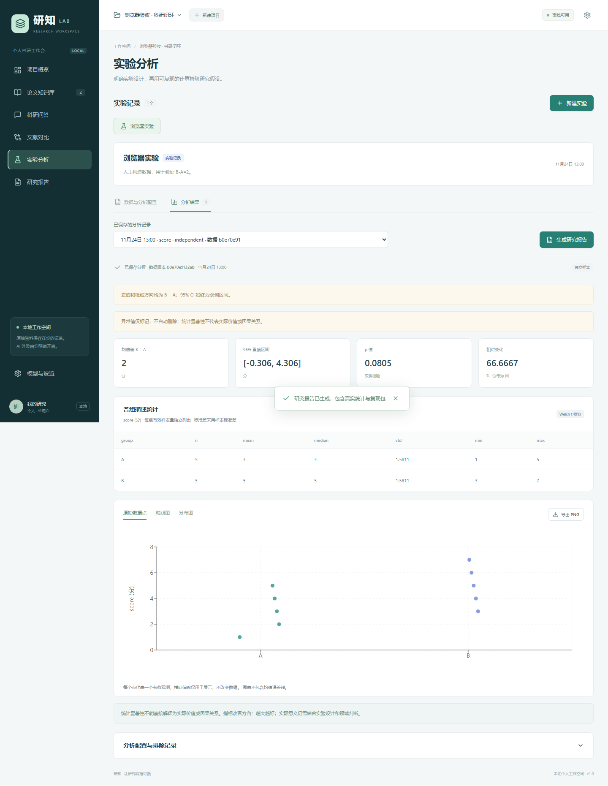

# 研知 · AI 科研论文知识库与实验分析助手

一个在本机运行的中文科研工作台：项目 → 论文入库 → 原文证据 → 实验分析 → 可复现报告。界面兼容中英文论文。所有示例均明确标为 DEMO / 测试材料，不代表真实科研发现。

技术设计：[面向计算机专业的架构与算法说明](docs/TECHNICAL_DESIGN.md)。

代码学习：[逐文件源码解读](docs/code-guide/README.md) · [离线完整源码阅读器](docs/code-guide/code-reader.html)。

## 在线演示

支持通过 Cloudflare Quick Tunnel 创建临时 HTTPS 演示链接，需要电脑保持开机；也提供可选的 Render 免费 Docker 部署配置。操作步骤见 [在线演示与部署说明](docs/DEPLOYMENT.md)。

公开演示使用独立的合成测试数据，默认只读并关闭模型调用。本机论文、数据库和密钥不会交给演示服务；完整功能继续通过下方本地启动方式使用。实际演示地址以启动脚本或部署平台返回的地址为准。

## 快速启动（Windows PowerShell）

需要 Python 3.12+、Node.js 20+（附带 npm）、可用的网络以首次安装依赖。当前验收环境为 Python 3.12.14、Node.js 24.14.1、npm 11.11.0。日常离线使用不需要模型密钥。

在项目根目录运行：

```powershell
.\scripts\setup.ps1
.\scripts\start.ps1
```

打开 <http://127.0.0.1:8000>；API 文档为 <http://127.0.0.1:8000/docs>。使用 Ctrl+C 停止服务。默认只监听 127.0.0.1。

安装脚本创建根目录 `.venv`、安装 `requirements.lock.txt`、执行 `npm ci` 和生产构建，并在缺少 `.env` 时复制模板。原有 `.env` 不会被覆盖。首次安装会访问 Python/npm 软件源。

如果 PowerShell 的本地脚本策略阻止运行，可以仅对当前进程使用：

```powershell
powershell -NoProfile -ExecutionPolicy Bypass -File .\scripts\setup.ps1
powershell -NoProfile -ExecutionPolicy Bypass -File .\scripts\start.ps1
```

指定 Python 或工具路径（路径可以包含空格）：

```powershell
.\scripts\setup.ps1 -Python 'C:\Program Files\Python312\python.exe'
.\scripts\setup.ps1 -Node 'C:\Program Files\nodejs\node.exe' -Npm 'C:\Program Files\nodejs\npm.cmd'
```

脚本依次探测 Windows `py -3`、PATH 中的 Python、当前用户的 Codex bundled runtime。已有 `.venv` 时直接复用；要更换解释器，请先自行备份并重命名旧虚拟环境。脚本不会安装或修改系统 Python/Node。

### 手动安装与开发

```powershell
py -3 -m venv .venv
.\.venv\Scripts\python.exe -m pip install -r requirements.lock.txt
if (-not (Test-Path .env)) { Copy-Item .env.example .env }
Push-Location frontend
npm.cmd ci
npm.cmd run build
Pop-Location
.\.venv\Scripts\python.exe -m uvicorn app.main:app --app-dir backend --host 127.0.0.1 --port 8000
```

开发模式运行 `.\scripts\dev.ps1`，访问 <http://127.0.0.1:5173>，后端仍为 8000。脚本以隐藏窗口启动自己管理的两个服务，日志位于 `data/dev-logs/`，Ctrl+C 会停止这两个进程。不要同时运行 `start.ps1` 与 `dev.ps1`。

生产模式由 FastAPI 直接提供 `frontend/dist`。修改前端后要重新执行 `npm.cmd run build`；日常启动无需启动 Vite。

## 第一次使用

1. 创建项目，填写研究问题、假设、标签和备注；或者点击明确标注的“导入演示数据”。
2. 在论文库批量上传带文本层的 PDF。等待解析完成，编辑元数据；无法可靠确定的作者、年份和 DOI 应由用户确认。
3. 搜索关键词，点击证据卡打开原 PDF 页面。支持按选定论文、年份和标签限定范围。
4. 在科研问答中选择单篇、多篇或项目范围。无模型时只显示真实检索片段；配置模型后生成带出处的回答、阅读卡和文献对比。
5. 创建实验，关联论文，上传 CSV 或 XLSX。XLSX 需要选定工作表；预览其他工作表不会改变已经保存的数据版本，若要分析另一工作表，请重新导入并选定它。
6. 手工确定实验单位、主要指标、两组比较、独立或配对设计、缺失值处理、检验方向，勾选确认后运行。
7. 检查有效样本量、排除记录、图表和限制，再创建研究报告并导出 ZIP。

项目切换会隔离论文检索、问答、实验、数据和报告。首页统计来自 SQLite。示例只在用户显式导入时建立，不会冒充个人科研数据。

## 离线与模型配置

**默认不配置、不启用模型。** 论文管理、PDF 解析、FTS5 关键词搜索、统计、模板报告和导出均可本地使用。界面不会用假回答代替模型。

编辑根目录 `.env`，重启后端，然后在设置页阅读数据发送说明并启用模型。适配器使用 Chat Completions 兼容接口和 Embeddings 接口；服务必须支持结构化 JSON 回答。接口参考：[Chat Completions](https://developers.openai.com/api/reference/resources/chat/subresources/completions/methods/create)、[Embeddings](https://developers.openai.com/api/reference/resources/embeddings/methods/create)。聊天与向量模型独立配置：

| 环境变量 | 用途 |
| --- | --- |
| `AI_BASE_URL` | 聊天服务 API 根地址，默认 `https://api.openai.com/v1` |
| `AI_API_KEY`、`AI_CHAT_MODEL` | 聊天密钥与模型；模型名必须填服务实际支持的值 |
| `AI_JSON_MODE` | 是否发送 `response_format=json_object`，默认 true |
| `AI_TOKEN_PARAMETER` | 输出 token 参数名，默认 `max_completion_tokens`；部分兼容服务需设为 `max_tokens` |
| `AI_TIMEOUT_SECONDS` | 请求超时，默认 45 秒 |
| `AI_MAX_OUTPUT_TOKENS`、`AI_CONTEXT_CHARS` | 默认 1800 token、18000 字符上下文 |
| `AI_RETRIES` | 默认重试 1 次，程序上限 2 次 |
| `EMBEDDING_BASE_URL` | 为空时使用聊天 API 地址 |
| `EMBEDDING_API_KEY`、`EMBEDDING_MODEL` | 向量服务独立密钥与模型；密钥不会隐式继承 |
| `EMBEDDING_MIN_SIMILARITY` | 语义召回余弦相似度下限，默认 0.35 |

本地兼容服务可填写 `http://127.0.0.1:11434/v1` 等实际服务地址；仅 localhost/127.0.0.1 本地服务允许不填密钥。模型是否支持 JSON 模式、具体字段及模型名以所用服务为准。

启用聊天会向所选服务发送问题、论文标题和检索原文片段；阅读卡会发送限制长度内的论文片段；分析建议会发送实验名称、假设、列名、质量概况和少量预览数据。启用向量会发送待索引的论文片段和搜索问题。密钥仅由后端读取，前端设置接口不返回密钥。

更换向量模型、服务地址或模型维度后，需要在设置中重新构建项目向量索引；索引缺失时关键词搜索仍可用。第一版使用 SQLite + NumPy 存储及计算向量，适用于个人规模资料库。

本次交付未提供真实 API Key，真实外部模型调用需要用户配置后验收；自动化测试使用测试桩验证引用校验、离线流程和接口行为。

## 统计约定与支持范围

- 每次分析指定一个主要指标，比较两组。独立样本使用 Welch t 检验；配对样本按显式 pair ID 匹配，使用配对 t 检验；也可只做描述统计。
- 差值始终为 **B - A**，相对变化为 `(B - A) / abs(A) × 100%`；A 均值为零时相对变化不计算。
- 单侧方向对应 B - A：`greater` 检验 B 更大，`less` 检验 B 更小；默认 `two-sided`。指标“越大越好/越小越好”只影响改善方向的解释。
- 均值、样本标准差（ddof=1）、中位数、最小值、最大值和有效 n 来自确定性计算。图表显示原始观测点，注明单位、样本量与区间含义。
- 缺失/无效指标默认阻止推断，只有显式选择排除后才计算并记录。异常值默认保留，不能因“看起来异常”自动删除。
- 重复的实验单位、重复配对 ID、缺失配对、样本不足和常量等情况会阻止不适用的推断或给出原因。不能根据行顺序配对，也不能把重复测量行视为独立样本。
- 清洗仅支持显式排除指定列缺失记录和完全重复行；生成新版本，保留原文件。更复杂的插补、聚类数据、多次测量、协变量调整、三组及以上检验、多重比较、功效分析尚未实现。
- t 检验的适用性仍需要研究者根据设计与数据判断；统计显著不能直接证明因果关系或实际价值。不同数据集、单位、评价协议下的论文结果不能直接排名。

AI 只建议分析配置，用户核对并确认后才能调用白名单统计函数。不会执行模型提供的 Python、SQL、shell 或 eval。报告数字取自持久化分析结果；报告本身采用可审查模板，不另让模型重新计算。

## 证据、PDF 与任务

PDF 按实际页面提取文本，保存页码、片段 ID、页内字符偏移和解析版本。引用核对 paper ID、chunk ID、PDF 页码及原文摘录是否来自本次提供的证据。

**引用存在不等于结论已被证明。** 图像、复杂表格、公式、多栏排版的提取可能不完整；阅读卡受上下文长度限制。检索只覆盖已成功提取并建立索引的文本。无匹配资料会明确提示资料不足。

纯扫描 PDF 标记“需要 OCR”，不会当作成功文本解析；第一版不包含 OCR。损坏文件会记录失败原因。任务具有 queued/running/completed/failed/interrupted 状态；服务重启会标记遗留任务中断，可手动重试。工作进程内任务适合本地单用户，不应以多个 Uvicorn worker 运行。

同一项目内按 SHA-256 去重 PDF；不同项目可各自导入同一材料。删除论文会清理文件、索引及相关条目，已经导出的报告是当时结果的快照。

## 导出与复现

报告可下载 Markdown、CSV 汇总、PNG、Python 脚本、分析配置 JSON，或下载包含全部资料的 ZIP。**完整复现应使用 ZIP**，单独的 `reproduce.py` 还需要包内的原始文件、配置和统计引擎。

ZIP 保存原始数据、`report.md`、`summary.csv`、`plot.png`、`box.png`、`histogram.png`、`reproduce.py`、`analysis_config.json`、`provenance.json`、`requirements.txt` 和统计引擎。记录数据哈希、清洗步骤、分析配置、排除记录、代码哈希、依赖版本。统计未使用随机过程，随机种子记为 null。

解压导出包到独立目录，按其脚本与依赖运行，例如：

```powershell
py -3 -m venv .repro-venv
.\.repro-venv\Scripts\python.exe -m pip install -r requirements.txt
.\.repro-venv\Scripts\python.exe reproduce.py
```

原始文件哈希不匹配时会拒绝创建可信复现包。报告生成后绑定分析快照，后续重新上传数据不会改写旧结果。

## 数据位置与备份

默认所有用户数据在根目录 `data/`，可在 `.env` 用 `DATA_DIR` 指向其他目录（相对路径基于项目根目录）：

- `research.db`：SQLite 数据库；`research.db-wal` / `research.db-shm` 可能在运行时出现。
- `papers/`：随机服务器文件名保存的原 PDF。
- `datasets/`：原始实验文件与清洗版本。
- `engines/`：保存分析时的统计引擎代码快照，复现与历史导出需要。
- `dev-logs/`：开发脚本日志。

迁移位于 `backend/app/migrations.py`，启动时执行，迁移版本保存在数据库；可重复启动。首次运行自动建立目录和表。

备份时先用 Ctrl+C 停止服务，再复制**整个 DATA_DIR**；只复制数据库会丢失原始文件。若不能停机，请使用 SQLite 一致性备份并同步文件，第一版未提供在线备份按钮。恢复时保持服务停止，将完整备份恢复到同一目录，或修改 DATA_DIR 后重启。迁移或升级前先备份。

`.env` 另行安全备份；它包含密钥，不应提交 Git、放进论文库或分享导出包。`.gitignore` 已忽略 `.env`、`data/`、虚拟环境和构建缓存。第一版数据未加密，请通过本机账户与磁盘权限保护。

## 资源限制

| 配置 | 默认值 |
| --- | --- |
| `MAX_UPLOAD_MB` | 单文件 30 MB |
| `MAX_PDF_PAGES` | 300 页 |
| `PARSE_TIMEOUT_SECONDS` | 60 秒 |
| `MAX_DATASET_ROWS` | 100000 行 |
| `MAX_DATASET_COLUMNS` | 200 列 |
| `MAX_XLSX_UNCOMPRESSED_MB` | XLSX 解压后合计 150 MB |

论文每批最多 20 个文件，总计 100 MB。只支持 PDF、CSV、XLSX；不支持旧版 XLS、宏工作簿或图片实验。默认本地单用户使用，没有登录、团队权限、加密、联网抓论文、知识图谱或自动实验执行。CORS 与请求来源仅允许列出的本地 UI 地址，不应把服务开放到公网。

## 示例与测试

`samples/` 包括：

| 文件 | 用途 |
| --- | --- |
| `demo_paper_zh.pdf`、`demo_paper_en.pdf` | 各 2 页，带明确测试标识、已知事实、PDF 页码 |
| `scanned_demo.pdf`、`corrupt_demo.pdf` | 需要 OCR / 解析失败路径 |
| `independent.csv` | 独立两组 A=[1,2,3,4,5]、B=[3,4,5,6,7] |
| `paired.csv` | 5 对样本，B-A=[1,2,1,3,2] |
| `missing_values.csv` | 缺失、非数值与待人工判断的极值 |
| `duplicate_pairs.csv`、`unmatched_pairs.csv` | 重复配对 ID、未匹配配对 |
| `experiments.xlsx` | 4 个可选工作表 |
| `expected_results.json` | 已知统计结果、证据所在页、无证据问题、样例哈希 |

需要重新生成时：

```powershell
.\.venv\Scripts\python.exe scripts/generate_samples.py
```

生成器使用 ReportLab、openpyxl、Pillow、pypdf 和 SciPy。中文字体优先嵌入 Windows 宋体；其他环境可用环境变量 `DEMO_CJK_FONT` 指定可嵌入的 TrueType 中文字体，缺少时回退 CID 字体。提交的中文测试 PDF 已包含字体子集。

运行后端测试和前端生产构建：

```powershell
.\scripts\test.ps1
```

浏览器测试：

```powershell
.\scripts\test.ps1 -E2E -InstallBrowsers
```

`-InstallBrowsers` 仅首次下载 Playwright Chromium 时需要。验收使用与 Playwright 匹配的 Chromium，临时占用 5173/8001，并将合成数据写入 tmp/e2e-*；请先停止占用这两个端口的开发服务，8000 的日常实例可以保留。测试桩不会产生真实模型费用。手动/API 验收与本次实测结果见 [docs/ACCEPTANCE.md](docs/ACCEPTANCE.md)。未运行的真实模型调用不能视为验收通过。

## 目录

```text
backend/app/       API、模型、迁移、PDF/检索、统计与导出
backend/tests/     数据隔离、证据、统计、导出等回归测试
frontend/src/      React / TypeScript / Tailwind 工作台
frontend/tests/    Playwright 关键流程
samples/           明确标识的合成测试材料
scripts/           PowerShell 生命周期脚本与样例生成器
docs/              接口计划、验收记录
requirements.lock.txt  Python 精确依赖
frontend/package-lock.json  npm 锁文件
.env.example       后端配置模板，不含密钥
```

常见问题：8000/5173 端口已占用时停止先前服务；PDF 解析失败先查看错误和任务状态；中文搜索可尝试正文中的实词；空白 PDF 不会自动 OCR；“未配置模型”需要填写配置、重启并启用；向量模型变化后要重建索引；图表计算异常时先检查指标列、实验单位、重复 ID 和缺失处理。

## 本次交付验证

当前已通过 92 项后端测试、12 项前端测试（7 项数值测试、3 项原有浏览器流程、1 项只读演示流程、1 项真实公网流程）和 TypeScript/Vite 生产构建。原有导出包的全新虚拟环境复现记录保留。真实外部模型调用尚需配置密钥后验证；Docker 镜像尚未构建验收。完整证据与限制见 [验收记录](docs/ACCEPTANCE.md)。


