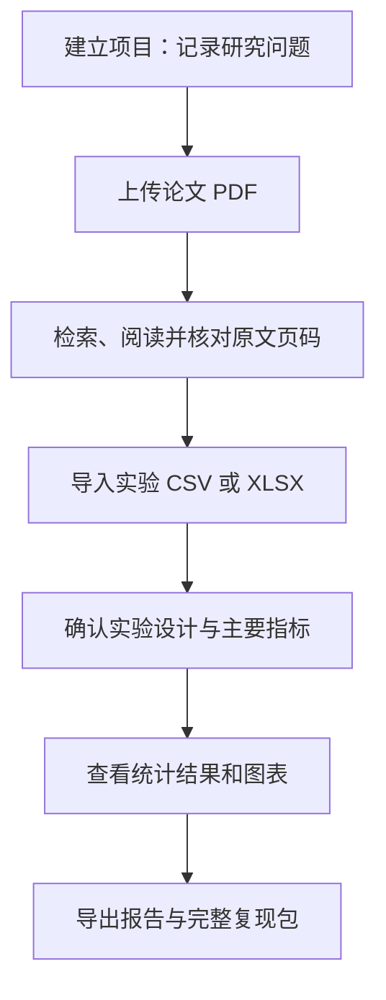
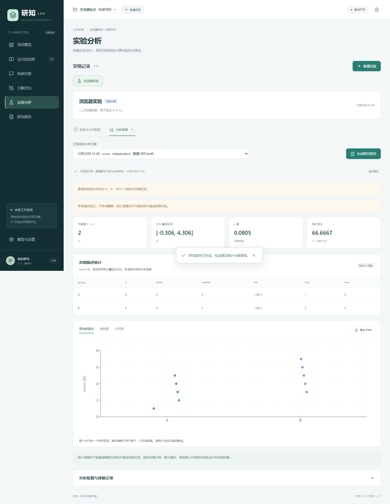
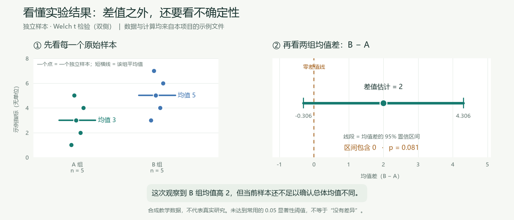
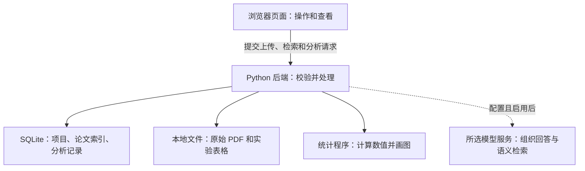

# 研知：零基础图文入门

这是按当前项目代码、真实界面和合成示例编写的使用说明。示例不代表真实科研发现。当前聊天模型和向量模型都未配置，AI 发送开关关闭；论文管理、关键词检索、实验统计和模板报告可以使用。

## 1. 先认识它能帮你做什么

你可以把研知理解成放在自己电脑上的科研工作台，里面有四种工具：管理论文的书架、定位原文的检索器、计算实验数据的统计工具、整理研究过程的报告工具。

例如，你想研究“方法 B 的评分是否比方法 A 高”。先记录问题和假设，收集相关 PDF，找到论文中的证据，再导入自己实际得到的实验表格，确认分析设计，最后查看统计结果并导出报告。软件整理和分析你提供的材料；研究问题、数据来源与实验设计仍由你决定。



项目是一个课题的资料夹。一个项目可以包含多篇论文、多次实验和多份报告；切换项目后，检索和实验资料也随之切换。

## 2. 页面分别有什么用

| 页面 | 通俗解释 | 你可以做什么 |
| --- | --- | --- |
| 项目概览 | 课题首页 | 看真实论文数量、任务、最近实验和报告 |
| 论文知识库 | 论文书架 | 上传 PDF、编辑标题和标签、做笔记、搜索；打开阅读器看原文 |
| 科研问答 | 带出处的资料问答 | 限定论文范围提问；无模型时查看真实检索片段 |
| 文献对比 | 论文比较表 | 选择 2—5 篇，配置聊天模型后整理方法、数据和局限 |
| 实验分析 | 实验记录本和统计工具 | 上传表格、检查质量、确认设计、计算和画图 |
| 研究报告 | 研究过程档案 | 整理文献、设计、结果与局限，下载报告或 ZIP |
| 模型与设置 | 可选 AI 的设置入口 | 查看配置状态、资料发送说明、启用状态和向量索引 |

下图是本项目实际验收界面，数据为合成测试数据。左侧选功能，顶部选项目，中间进行操作。查看论文证据时可展开右侧证据面板。



## 3. 跟着做一次练习

项目已经安装过，日常在 PowerShell 中运行：

```powershell
cd E:\agent
.\scripts\start.ps1
```

然后打开 http://127.0.0.1:8000/ 。如果页面已经正常打开，就直接使用。127.0.0.1 表示自己的电脑，8000 是这个程序使用的服务端口。关闭网页不会清空资料；停止服务后需要重新启动才能继续访问。

### 第一步：建一个练习项目

点击“新建项目”。名称可以填“我的第一个科研练习”，研究问题填“方法 B 的评分是否高于方法 A”，研究假设填“B 的平均评分可能更高”。假设是准备检验的预期，还不是已经证明的结论。

### 第二步：上传论文并找原文

在“论文知识库”上传 samples/demo_paper_zh.pdf，也可以同时上传英文 demo_paper_en.pdf。这些文件都带测试标识。等待解析完成，搜索“均值差”，打开证据并跳转原 PDF 页面。

解析的意思是把 PDF 中能选中的文字提取出来，保存所属论文和实际 PDF 页码，便于搜索。这里的页码按 PDF 第几页计算，不一定等于页面上印刷的页码。纯图片扫描件会显示“需要 OCR”；本版没有 OCR 功能。损坏文件显示失败原因。同一项目重复上传同一 PDF 会识别为重复。

### 第三步：理解检索与 AI 问答的区别

可以提问“示例实验每组有多少个独立样本？”。中文测试论文第 1 页有“每组包含 5 个独立样本”的原文。

关键词检索是找出相关段落；AI 问答是在找到的段落基础上组织回答。当前没有配置模型，因此应看到未配置提示和真实片段。不要把这些片段展示当成已经调用了 AI。

### 第四步：导入实验数据

在“实验分析”新建实验，导入 samples/independent.csv。CSV 是一种普通文本表格，可以用 Excel 打开；XLSX 是常见的 Excel 工作簿格式，导入时要选择工作表。

| 字段 | 意思 | 示例 |
| --- | --- | --- |
| sample_id | 每个实验单位的编号 | A1、A2、B1 |
| group | 属于哪一组 | A 或 B |
| score | 要分析的数值指标 | 1、2、3…… |
| pair_id | 配对编号 | 本独立样本示例留空，不用于分析 |

这份示例共有 10 行：A 组为 1、2、3、4、5；B 组为 3、4、5、6、7。所有数值都是人工构造的教学材料。

### 第五步：明确告诉程序怎么分析

| 界面配置 | 本例填写 |
| --- | --- |
| 分组列 | group |
| 主要指标列 | score |
| 指标单位 | 分 |
| 基准组 A / 比较组 B | A / B |
| 指标方向 | 越大越好 |
| 分析设计 | 独立样本 · Welch t 检验 |
| 实验单位 | 独立样本（教学示例） |
| 实验单位 / 样本 ID 列 | sample_id |
| 缺失与无效值处理 | 发现后停止，交由我处理 |
| 检验方向 | 双侧 · B 与 A 不同 |

实验单位指能够独立提供一次信息的对象。10 个人各测一次，与 1 个人测 10 次，不是同一种设计。独立设计一般用于两组不同对象；配对设计一般用于同一对象前后测量或有明确匹配关系的对象，必须使用配对 ID。表格中上下相邻或位于同一行，不能自动证明配对关系。

双侧表示检查两组是否不同，不事先只接受某个方向。看到结果以后再改方向会改变检验的含义。核对数据版本和设计，勾选确认后再运行。当前只做一个主要指标、两组之间的推断分析。

### 第六步：看懂输出



| 输出 | 本例结果 | 怎么理解 |
| --- | --- | --- |
| 有效样本量 n | A、B 各 5 | 实际进入此次计算的有效观测数 |
| 均值 | A=3，B=5 分 | 每组数值的平均数 |
| 中位数 | A=3，B=5 分 | 每组排序后居中的数值 |
| 样本标准差 | 两组都约 1.581 分 | 数据围绕均值有多分散，不是均值差的置信区间 |
| 均值差 B−A | 2 分 | 本次观察到 B 组平均高 2 分 |
| 相对变化 | 约 66.67% | 差值 2 除以基准均值 3；不自动表示实际价值高 |
| 均值差的 95% 置信区间 | 约 −0.306 到 4.306 分 | 反映差值估计的不确定性，区间包含 0 |
| 双侧 Welch 检验 p 值 | 约 0.0805 | 若事先使用 0.05 门槛，本例未达到该门槛 |

左图每个点对应一个样本，短横线表示组均值。右图圆点表示差值估计 2，横线表示差值的 95% 置信区间；它跨过了代表零差值的虚线。

可以说“本次样本中 B 的平均分更高，但在所用检验假设下，证据还不足以确认总体均值不同”。不能据此说“B 已经被证明更好”，也不能说“已经证明两者没有差异”。p 值不是假设为真的概率；它描述在总体均值相等及检验假设成立时，观察到当前或更极端结果的概率。

界面另外提供箱线图和分布图：箱线图帮助看中间位置、离散程度和极端观测；分布图帮助看不同数值区间聚集了多少样本。样本很少时，优先看原始点，不能只看一个均值。

### 第七步：生成并保存报告

选择已保存的分析记录，点击“生成研究报告”，再到“研究报告”下载。Markdown 适合继续修改文字，CSV 适合检查汇总表，PNG 适合插入文档，JSON 保存分析配置。

需要复现时下载完整 ZIP，其中包含原始实验文件、配置、统计代码、依赖要求、结果和图表。单独的 Python 脚本还需要这些配套文件。复现表示用同样的数据和方法重新得到同样的计算结果，不等于证明原始数据或研究假设必然正确。

## 4. AI 怎样参与，哪些地方仍需要你判断

本项目先在当前项目、选定论文范围内检索，再把相关原文片段交给已经配置并启用的聊天模型。回答附论文标题、PDF 页码和摘录，你可以点击回到原文。这种做法常叫“检索增强生成”，简称 RAG。

程序会核对引用是否来自这次提供给模型的片段，包括论文 ID、片段 ID、页码和原文摘录。引用能够找到，只说明出处可核对，不能自动证明整段推理成立。无关证据不能支持结论，论文内容本身也可能有局限。

聊天模型负责组织语言、辅助阅读和提出配置建议；向量模型用于按含义找相近片段。两者可分别配置。模型不负责重新计算统计数值，也不会把输出的 Python、SQL 或 shell 当成代码执行。

目前两种模型均未配置。以后需要时，按 README 在后端 .env 中填写实际服务地址、模型名和密钥，再重启并在设置页确认资料发送范围。使用外部服务时，问题、检索片段以及某些功能需要的数据概况会发送到所选服务。先完成离线练习，不需要现在购买或配置模型。

## 5. 前端、后端、数据库分别是什么



| 名称 | 在这个项目中做什么 | 初次使用需要懂吗 |
| --- | --- | --- |
| React / TypeScript / Tailwind | 构建你在浏览器里操作的页面 | 不需要 |
| FastAPI / Python | 接收请求、解析文件、检索、组织分析和导出 | 不需要 |
| SQLite / SQLAlchemy | 保存和读写项目、论文与分析记录 | 不需要安装独立数据库服务 |
| pypdf / PDF.js | 前者提取文本，后者在页面里显示原 PDF | 不需要 |
| pandas / NumPy / SciPy | 读取表格并执行确定性的统计计算 | 需要先理解数据和实验设计 |
| Matplotlib | 导出可以保存的 PNG 图表 | 不需要 |

API 可以理解成页面与后台约定好的办事窗口。你点“运行分析”，页面把所选配置交给后端，后端校验后计算，再把结果返回页面。模型只是其中一个可选部件。

## 6. 数据为什么重启后还在

程序默认把用户资料存到 data/：research.db 保存项目和记录，papers/ 保存原 PDF，datasets/ 保存原始与清洗数据，engines/ 保存分析代码快照。重启只是关闭并重新运行程序，不会主动清空这些资料。

原始数据是导入的原件；清洗版本是记录明确处理步骤后生成的新版本；分析记录绑定其中一个确定版本和配置；报告绑定已保存结果。后来再上传文件，不会悄悄改掉旧报告中的数字。

清洗前先看缺失、非数值、重复记录和异常值提示。异常值只是值得检查的点，默认保留。程序不会静默填补缺失值，也不会擅自改变单位。

备份时先停止服务，再复制整个 data/ 文件夹。只保存数据库会遗漏 PDF 和实验原文件；.env 是单独的配置文件，含密钥时不要随资料分享。

## 7. 先记住这些边界

本版面向本地单用户，主要处理有文本层的 PDF、CSV 和 XLSX。它没有扫描 OCR、自动上网抓论文、团队权限和自动做实验功能。

推断分析目前支持两组独立样本 Welch t 检验和严格匹配的配对 t 检验。重复测量、聚类、三组及以上等设计需要其他方法；本版无法妥善处理时，应保留描述统计并阅读限制提示。不要为了让程序给出 p 值而把真实设计改成独立样本。

第一次使用时，完成“建项目 → 上传中文示例 PDF → 搜索均值差 → 打开原文 → 导入 independent.csv → 确认设计 → 生成报告”这一条路线即可。理解每个按钮对应的科研动作，比先记住所有技术名词更有帮助。

进一步查阅：[安装和维护说明](../README.md)、[实际验收记录](ACCEPTANCE.md)、[教学图绘图源码](guide-example-statistics.py)。
